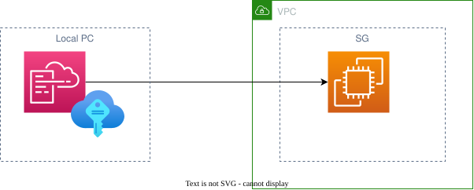

# プロジェクト概要
cfnの練習のための環境構築が自動で行われるプロジェクト
local PCからce2に接続しec2上のcfnからawsサービスを作成する。


# 仕様
- ymlを使用
- ec2を作成
- 作成するIAM ユーザに以下のpolicyが必要

|policy|用途|
|---|---|
|AmazonEC2FullAccess|ec2上でlocalpcのようにすべての操作を行う|
|AWSCloudFormationFullAccess|ec2からCloudFormationを操作する|
|AmazonSSMReadOnlyAccess|AMIIDの読み取りを行う|
|IAMFullAccess|EC2がSSMに登録され、通信するため|


# 主な機能

## 使い方
- ec2環境の作成
    ```
    ./setup/setup.sh my-profile up
    ```
- ec2環境の削除
    ```
    ./setup/setup.sh my-profile down
    ```

- ec2環境の停止
    ```
    ./setup/setup.sh my-profile stop
    ```

- ec2環境の起動
    ```
    ./setup/setup.sh my-profile start
    ```

## セットアップ手順
1. shfileに実行権限の付与
    ```
    chmod +x ./setup/setup.sh
    ```

1. sshkeyの作成
    ```
    ./setup/setup.sh my-profile create_sshkey
    ```
# ディレクトリ構成

# 構成図
- 

